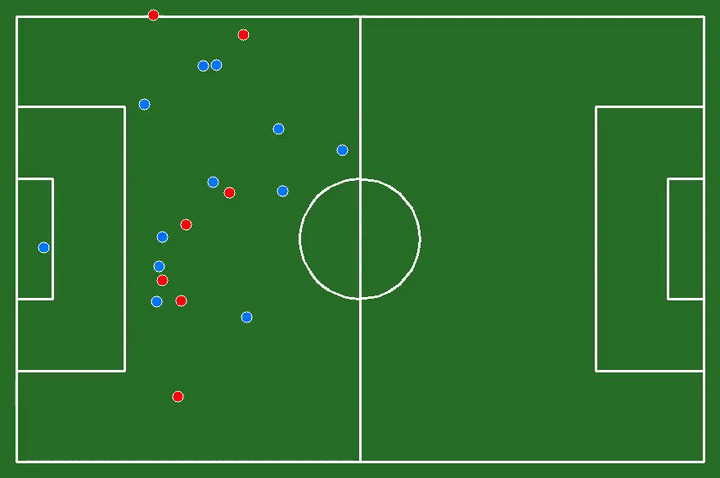
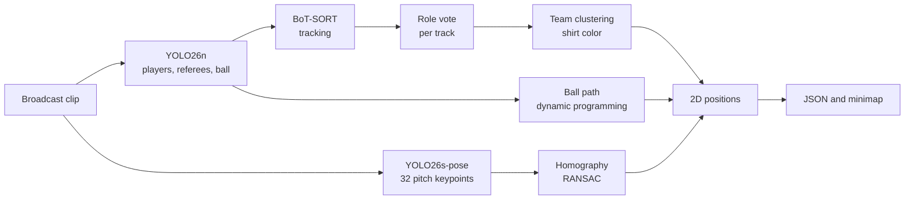
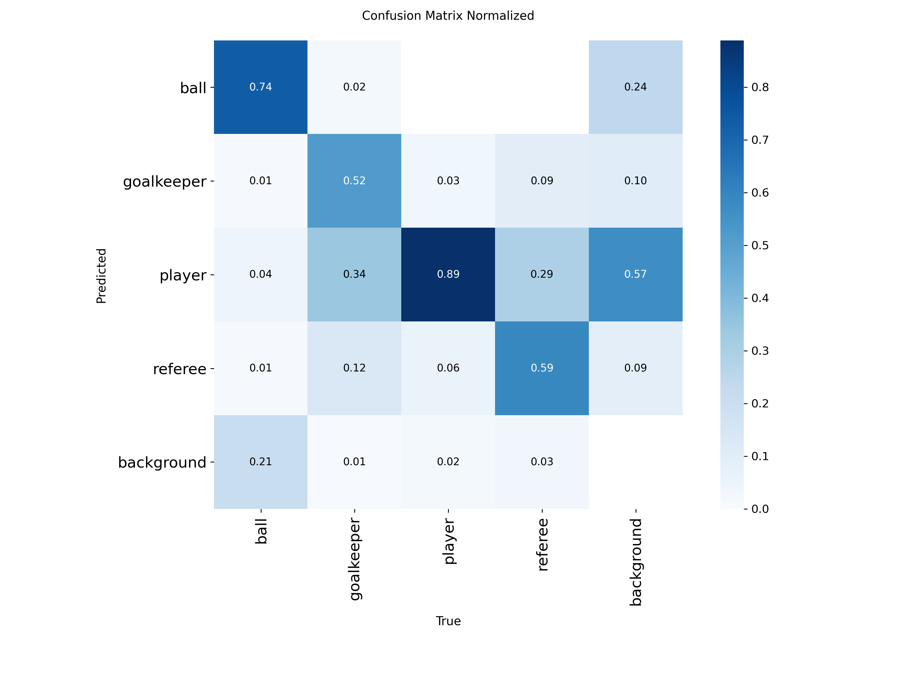
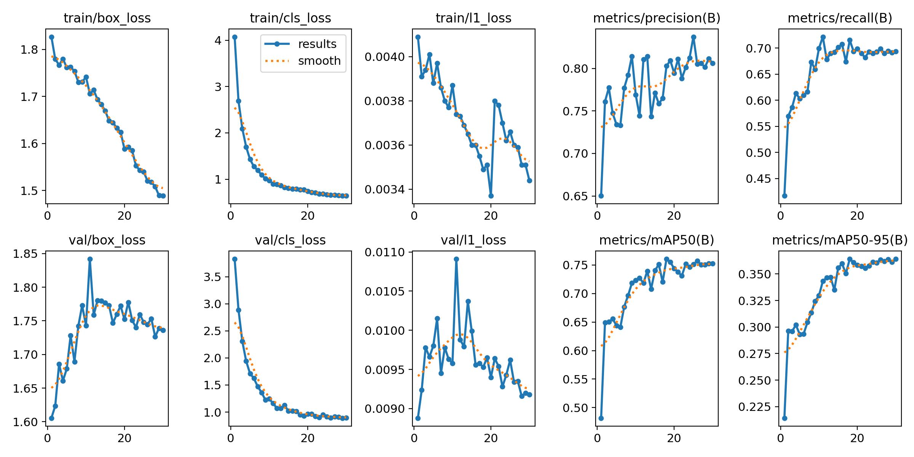

# Football analytics: from broadcast video to a 2D minimap


Give it a short broadcast clip and it returns where every player, the referee and the ball are on a top-down pitch.
The pipeline detects and tracks people, groups them into teams by shirt color, locates the pitch lines to estimate the camera, and projects everything onto a 105 × 68 m pitch.
A FastAPI backend wraps it as an upload-and-wait job queue, and an Angular app plays the result back.



*The minimap above contains only 2D coordinates. No footage is included in this repository.*

## What it does



1. **Detection.** YOLO26n at 1280 px finds players, goalkeepers, referees and the ball.
2. **Tracking.** BoT-SORT (with camera-motion compensation) links detections over time. Each track gets one role by a confidence-weighted vote, which removes most frame-to-frame label flicker.
3. **Teams.** For each player track, the median Lab color of the shirt area (grass pixels masked out) is clustered with k-means into two teams.
4. **Ball.** The ball is tiny, so the detector runs at a low confidence threshold. The best path over all candidates is picked by dynamic programming (confidence, plausible speed, gaps), and short gaps are interpolated.
5. **Pitch.** YOLO26s-pose predicts 32 pitch keypoints. A RANSAC homography maps them to real pitch coordinates (meters) in every frame.
6. **Projection.** The foot position of each track is mapped through the inverse homography and smoothed with a short median filter.

## Results

All detection numbers are on the **validation** split of my group-based re-split of the dataset (see [Data](#data-and-a-leakage-problem-i-had-to-fix)).

### Detector (YOLO26n, 1280 px, 30 epochs, ~49 min on a T4)

| Class | Precision | Recall | mAP50 | mAP50-95 |
|---|---|---|---|---|
| player | 0.928 | 0.929 | 0.937 | 0.476 |
| referee | 0.850 | 0.771 | 0.841 | 0.410 |
| goalkeeper | 0.718 | 0.571 | 0.667 | 0.302 |
| ball | 0.723 | 0.502 | 0.566 | 0.268 |
| **all** | **0.805** | **0.693** | **0.753** | **0.364** |

Going from 640 px to 1280 px was the single most useful change: mAP50 rose from 0.682 to 0.753 and ball recall from 0.386 to 0.502.
The ball is about 24 px wide at the native 1920 × 1080 and shrinks to roughly 8 px at 640.
Inference takes about 10 ms per image on a T4 at either size.




### Pitch keypoints (YOLO26s-pose, 960 px, 100 epochs, ~36 min on a T4)

| Check | Result |
|---|---|
| Pose mAP50-95 on the dataset's validation split (34 images) | 0.708 |
| Layout check: homography fitted on the human-annotated keypoints | 34 / 34 images, median reprojection error 1.5 px |

The second row checks that my 32-point pitch layout (in meters) matches the dataset's labels. It does not measure the model.
The first row is optimistic: the dataset split is random per frame and its images come from a small set of stadiums.

### End to end on a 15 s test clip (1920 × 1080, 60 fps, 922 frames)

| Stage | Result |
|---|---|
| Detections to tracks | 12,399 detections, 166 raw tracks, 77 after dropping tracks shorter than 15 frames |
| Pitch detected | 922 / 922 frames |
| Homography found | 900 frames |
| Detections placed on the minimap | 11,368 |
| Frames with a reliable ball position | 545 (59%) |
| Runtime, full pipeline | 97 s on an RTX 5060 laptop GPU, about 2 min 40 s on a Colab T4 |

Counts differ by a few detections between GPUs (for example 78 tracks instead of 77), most likely from different hardware and library builds.
There is no ground truth for this clip, so I cannot give a position error in meters.

## Data and a leakage problem I had to fix

The detector is trained on [detection-player v4](https://universe.roboflow.com/fsdm-olss1/detection-player/dataset/4) (Roboflow Universe, CC BY 4.0): 4 classes (ball, goalkeeper, player, referee), 2,329 images.

Roboflow splits frames at random, and these frames come from only a handful of videos.
I measured the damage with perceptual hashes (including mirrored copies, because of flip augmentation): **93% of the validation images (289 of 310) and 94% of the test images (165 of 175) had a near-duplicate in the training set.** Any metric computed on that split would be inflated.

What I did instead:

1. Hash every image and its horizontal mirror, then link images whose hashes are close. Connected components give 223 groups of visually similar frames.
2. Split by group, not by frame: about 70 / 15 / 15.
3. Remove augmented copies of the same source image from validation and test.

Final split: **1,630 train / 275 validation / 298 test** images. The test split is kept untouched and has **not** been evaluated yet.
`artifacts/split_manifest.csv` lists the split of every file.

The pitch model uses [football-field-detection-f07vi v18](https://universe.roboflow.com/roboflow-jvuqo/football-field-detection-f07vi/dataset/18) (Roboflow, CC BY 4.0): 317 images, 32 keypoints per image.
I used the dataset's own split for that model.

No dataset and no video is stored in this repository.

## Limitations

- **Positions are approximate.** The pitch model was trained on a few stadiums with an elevated camera. On my test clip the projected lines are off by tens of pixels in some frames, especially in zoomed shots near a goal. This is why distance, speed and possession statistics are not implemented yet: they would look precise without being so.
- **The ball is the weak point.** Recall is about 0.5 on the validation split, and only 59% of the frames of the test clip have a reliable ball. The minimap also places the ball with the ground-plane homography, so a ball in the air is projected to the wrong spot.
- **Goalkeepers and referees** are often labeled as players (see the confusion matrix). Roles are voted per track, which helps but does not fix it.
- **Teams are two arbitrary clusters.** Shirt color works when kits differ clearly. Team "A" and "B" have no fixed meaning, and goalkeepers in a third color are not handled.
- **Tracks are fragmented.** The test clip has 77 tracks for roughly 22 people, because of occlusion and camera cuts.
- **Small data.** The detector saw about 1,600 training images from a limited set of matches. Expect lower quality on other competitions, camera angles and kits.
- **Test split not evaluated.** The numbers above are validation numbers.

## Repository layout

```
football-analytics/
├── notebooks/        # experiments, run on Google Colab (T4)
├── ml/               # the pipeline as a package
│   ├── detection/    # detector, ball candidates, training helpers
│   ├── tracking/     # BoT-SORT wrapper, role vote, ball path
│   ├── teams/        # shirt-color features and clustering
│   ├── pitch/        # keypoint model, 32-point layout, homography
│   ├── utils/        # video I/O, minimap drawing
│   ├── export.py     # positions to JSON
│   └── pipeline.py   # end-to-end entry point
├── backend/          # FastAPI job queue
├── frontend/         # Angular viewer
├── artifacts/        # model weights, split manifest
├── docs/             # figures used in this README
└── tests/            # unit tests (pytest)
```

Notebooks, in order:

| Notebook | Content |
|---|---|
| `01_data_exploration` | Download, class balance, leakage measurement, group split |
| `02_train_detector` | 640 px baseline, then 1280 px |
| `03_tracking_and_teams` | Tracking, role vote, team clustering, ball path, overlay video |
| `04_pitch_homography` | Pitch keypoint model, layout check, homography, minimap |

## Getting started

Requirements: Python 3.12, `ffmpeg` on your `PATH`, Node.js 22.22.3 or newer (24.15+ or 26+ also work; only for the frontend), and an NVIDIA GPU (the pipeline runs on CPU, but slowly).

```bash
git clone https://github.com/wassimab565-hub/football-analytics.git
cd football-analytics
python -m venv .venv
source .venv/bin/activate          # Git Bash on Windows: source .venv/Scripts/activate
```

Install PyTorch first, using the command for your GPU from [pytorch.org](https://pytorch.org/get-started/locally/). RTX 50-series cards need a build for CUDA 12.8 or newer. Then:

```bash
python -m pip install -r backend/requirements.txt
python -m pytest -q
```

### Run the pipeline on a clip

The two weight files are expected in `artifacts/`: `detector_yolo26n_1280.pt` and `pitch_yolo26s_pose_960.pt`.

```bash
python -m ml.pipeline \
  --video path/to/clip.mp4 \
  --detector artifacts/detector_yolo26n_1280.pt \
  --pitch-model artifacts/pitch_yolo26s_pose_960.pt \
  --out outputs/my_clip
```

It writes CSVs for each stage, `result.json` (positions per frame), a minimap video and a GIF.

### Run the backend and the frontend

```bash
python -m uvicorn backend.app.main:create_app --factory --port 8000
```

In a second terminal:

```bash
cd frontend
npm install
npx ng serve
```

Open `http://localhost:4200`. The sample clip plays without the backend. "Your clip" uploads an `.mp4` (up to 20 s and 100 MB) and follows the job until the result arrives.

| Endpoint | Purpose |
|---|---|
| `GET /health` | `{"status": "ok", "live": true}`. `live` is false if the weights are missing |
| `POST /api/jobs` | Upload an `.mp4`. Returns `{"id": ...}` |
| `GET /api/jobs/{id}` | `status` (`queued`, `running`, `done`, `failed`), `stage`, `progress`, `queue_position`, `error` |
| `GET /api/jobs/{id}/result` | The positions as JSON. Returns 409 until the job is done |
| `GET /api/demo` | The precomputed sample result |

One job runs at a time, so an 8 GB GPU is enough. Configuration through environment variables: `DETECTOR_WEIGHTS`, `PITCH_WEIGHTS`, `JOBS_DIR`, `DEMO_JSON`, `MAX_UPLOAD_MB`, `MAX_SECONDS`, `CORS_ORIGINS`.

`result.json` format: `fps`, `n_frames`, `pitch` (length and width in meters) and, for every frame, `players` as `[track_id, team, class, x, y]` (team is -1 when unknown, class 2 is a player and 3 a referee) and `ball` as `[x, y]` or `null`.

### Tests

```bash
python -m pytest -q          # ML pipeline and backend
cd frontend && npx ng test --watch=false
```

The Python tests run the full pipeline logic with fake models on synthetic video, so they need neither a GPU nor weights.

## Roadmap

- Evaluate once on the held-out test split.
- Fine-tune the pitch model on frames from broadcast footage closer to real use, and measure the position error against hand-annotated points.
- Train a larger detector (YOLO26s) and a dedicated ball model.
- Possession, distance and speed, once the calibration is accurate enough to trust them.
- Merge fragmented tracks with appearance features.

## Credits and licenses

- Detection data: [detection-player v4](https://universe.roboflow.com/fsdm-olss1/detection-player/dataset/4), Roboflow Universe workspace `fsdm-olss1`, CC BY 4.0.
- Pitch keypoint data: [football-field-detection-f07vi v18](https://universe.roboflow.com/roboflow-jvuqo/football-field-detection-f07vi/dataset/18), Roboflow, CC BY 4.0. My 32-point layout follows the dataset's keypoint order.
- Models and tracker: [Ultralytics](https://github.com/ultralytics/ultralytics) YOLO26 and BoT-SORT. OpenCV, scikit-learn, FastAPI and Angular do the rest.
- Ultralytics is licensed under AGPL-3.0 (with a separate commercial license), and this project builds on it, so I release this repository under the **GNU AGPL-3.0**. See `LICENSE`.

The test clip is broadcast footage that belongs to its rights holders. It is not distributed here and was used only to test the pipeline.

## Author

Wassim ([@wassimab565-hub](https://github.com/wassimab565-hub))
